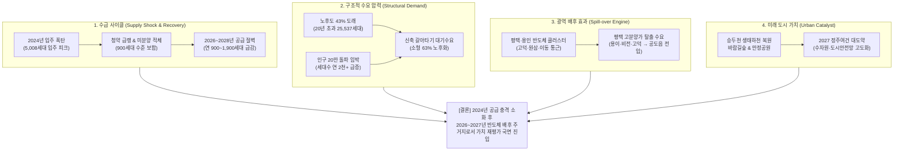
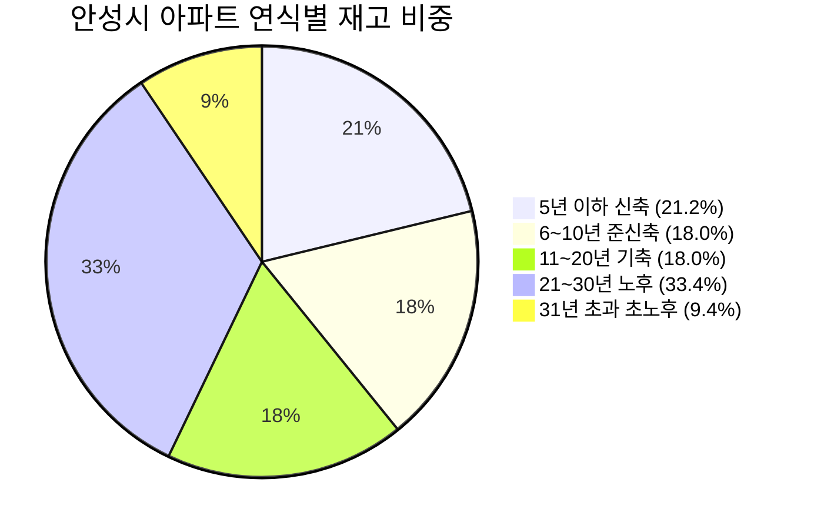
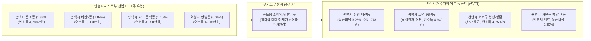

# [Market Intelligence Report] 경기도 안성시 주택시장 종합 진단 및 미래 성장 전략 보고서
> **기준 시점**: 2026년 하반기 (원천 데이터: 부동산R114 PropX, KCB K-Atlas 2.0, 행정안전부 주민등록통계, 국토교통부 주택통계, 안성시 개발계획)  
> **조사 및 분석**: 부동산 빅데이터 인텔리전스 리서치팀  
> **보고서 성격**: 안성시 주택 수급, 가격/청약/미분양, 차주 금융(소득·소비·대출), 인구 이동(통근·이주), 핵심 개발호재 융합 턴키 분석 보고서

---

## Executive Summary (핵심 종합 요약)



1. **수급 사이클의 대전환 (2024년 공급 피크 통과 후 2026~2028년 공급 급감)**
   * 안성시 주택시장은 2021~2023년 집중된 분양(3개년 합계 11,084세대)의 여파로 **2024년 역대 최대치인 5,008세대의 입주 폭탄**을 겪으며 청약 경쟁률 급락 및 미분양 적체(900호대)의 단기 침체를 겪었습니다.
   * 그러나 신규 인허가 및 착공 위축으로 향후 입주물량은 **2025년 2,728세대 → 2026년 1,989세대 → 2027년 976세대 → 2028년 945세대**로 급격히 축소됩니다. 2024년 공급 쇼크의 잔여 매물이 소화되는 2026년 하반기를 기점으로 수급 밸런스가 급격히 개선될 전망입니다.

2. **재고 노후도 42.9% 도래 및 내부 갈아타기 유효수요 잠재력**
   * 안성시 전체 아파트 재고 59,553세대 중 **21년 이상 노후 주택이 25,537세대(42.9%)**에 달합니다.
   * 특히 전체 재고의 절반을 차지하는 **전용 60㎡ 이하 소형 주택의 63.1%(18,323세대)**가 20년 이상 노후화되어, 주거 상향 및 신축 이동 욕구가 임계점에 도달해 있습니다.

3. **K-Atlas 데이터로 실증된 '평택·용인 반도체 배후 대체주거지' 위상**
   * KCB K-Atlas 광역 이주 및 통근 빅데이터 분석 결과, 안성시 거주자의 외부 통근 1위는 **평택시(신평·비전·고덕·송탄 등)**이며, 외부 전입(이주) 역시 **평택시(용이동, 비전동, 고덕동 등)**에서 가장 대규모로 유입되고 있습니다.
   * 평택 고덕신도시 및 비전동의 높은 분양가와 전세가 부담을 회피한 실수요층이 안성 공도읍 및 원도심 신축으로 대거 유입되는 **'스필오버(Spill-over) 낙수효과'**가 확고히 작동하고 있습니다.

4. **2027 정주여건 대도약 및 친환경 인프라 확충 모멘텀**
   * 안성시는 **승두천 생태하천 복원, 도시 바람길 숲, 만정유적공원 리모델링(2028), 안성IC 관문 경관 정비** 등 도심 생태 축을 획기적으로 개선하고 있습니다.
   * 여기에 55km 광역 상수도망 확충(유수율 88% 달성) 및 ICT·AI 기반 재난 예경보 시스템을 완비하여, 단순 외곽 베드타운이 아닌 친환경 자족 스마트 도시로 진화 중입니다.

---

## 01. 안성시 도시 개황 및 거시 정주 여건 분석

### 1. 인구 및 세대수 추이 (인구 20만 돌파 임박 및 세대 분화)
* 안성시 총인구는 2018년 183,579명에서 2020년 18.7만 명, 2024년 193,949명, **2025년 기준 196,592명**으로 가파른 우상향 곡선을 그리며 **'인구 20만 명' 돌파를 눈앞**에 두고 있습니다.
* 세대수는 1~2인 가구 분화 및 신규 아파트 입주에 힘입어 2018년 79,805세대에서 **2025년 97,042세대**로 무려 17,237세대(+21.6%) 급증했습니다. 세대당 인구는 2008년 2.53명에서 2025년 2.02명 수준으로 감소하며 소형·중소형 주택에 대한 실질 가구 수요가 크게 팽창하고 있습니다.

#### [표 1-1] 안성시 연도별 인구 및 세대수 변동 추이 (행정안전부 주민등록통계)
| 기준연도 | 총인구수 (명) | 전년대비 증감 | 총 세대수 (세대) | 전년대비 증감 | 세대당 인구 (명) | 인구 구조 시사점 |
| :---: | :---: | :---: | :---: | :---: | :---: | :--- |
| **2018년** | 183,579 | - | 79,805 | - | 2.30 | 인구 정체 국면 |
| **2020년** | 187,012 | +3,607 | 85,839 | +4,240 | 2.18 | 공도·아양지구 입주 시작 |
| **2022년** | 188,842 | -692 | 89,951 | +833 | 2.10 | 세대수 9만 세대 육박 |
| **2024년** | 193,949 | +4,915 | 94,809 | +3,783 | 2.05 | 5,000세대 대규모 입주 효과 |
| **2025년** | **196,592** | **+2,643** | **97,042** | **+2,233** | **2.02** | **인구 20만 명 진입 가시화** |

#### [표 1-2] 안성시 읍·면·동별 인구 및 세대 분포 현황
| 읍면동 구분 | 총인구수 (명) | 총 세대수 (세대) | 세대당 인구 (명) | 지역별 인구 점유비 | 주거 지역 특성 |
| :--- | :---: | :---: | :---: | :---: | :--- |
| **공도읍** | **57,245** | **21,318** | **2.69** | **29.1%** | **평택 인접 최대 주거벨트 (젊은 3~4인 가구 밀집)** |
| **안성3동** | 22,427 | 8,063 | 2.78 | 11.4% | 당왕지구 및 아양택지 배후 주거 신도심 |
| **안성2동** | 18,808 | 7,411 | 2.54 | 9.6% | 아양택지개발지구 중심 신흥 주거타운 |
| **안성1동** | 12,759 | 5,334 | 2.39 | 6.5% | 구도심 상업·행정 중심지 |
| **대덕면** | 10,982 | 6,182 | 1.78 | 5.6% | 중앙대학교 배후 대학가 (1인 가구 비중 극대) |
| **기타 10개 읍면**| 74,371 | 48,734 | 2.05 | 37.8% | 보개, 미양, 일죽, 죽산, 원곡 등 농촌·산업 혼합지역 |
| **안성시 전체** | **196,592** | **97,042** | **2.02** | **100.0%** | **공도읍 + 안성2·3동이 전체 인구의 50.1% 장악** |

---

### 2. 핵심 개발호재 및 2027 미래 비전 분석 (`개발보고서.docx` 융합)

```
┌─────────────────────────────────────────────────────────────────────────┐
│                    [안성시 친환경 도심 생태계 & 인프라 아키텍처]               │
└─────────────────────────────────────────────────────────────────────────┘
        ▲                                                          ▲
        │ (상류 왕벚나무 식재 연계)                                   │ (경관 및 문화축 통합)
┌───────┴──────────────┐                                   ┌───────┴──────────────┐
│  승두천 생태하천 복원   ├───────────────────────────────────┤   도시 바람길 숲 조성   │
│ (공도 도심 수변공간 확충)│                                   │ (미세먼지 저감·열섬 완화)│
└───────┬──────────────┘                                   └───────┬──────────────┘
        │ (도심 공원 거점 연계)                             │ (관문 및 수변 연계)
┌───────┴──────────────┐                                   ┌───────┴──────────────┐
│  만정유적공원 리모델링  ├───────────────────────────────────┤ 안성 IC 경관 개선 사업  │
│(2028년 열린 광장공원) │                                   │  & 안성천 정원 기본구상 │
└──────────────────────┘                                   └──────────────────────┘
        │ (문화·여가 공간 확장)
┌───────┴──────────────┐
│  복남동 박두진 공원   │ ➔ 2027년 기존 건축물 철거 후 문화공원 착공
└──────────────────────┘
```

1. **도심 생태계 복원 및 친환경 녹색 인프라**:
   * **공도 승두천 생태하천 복원**: 공도읍 도심 핵심 하천의 수질을 개선하고 자연형 수변 휴식 공간을 조성하여 인근 주거 밀집 단지(KCC스위첸, 블루밍, 금호어울림 등)의 쾌적성을 극대화.
   * **도시 바람길 숲 조성**: 외곽 녹지대의 맑은 공기를 도심으로 끌어들이는 바람길 축을 연결하고, 승두천 상류부에 왕벚나무를 식재하여 수변-녹지 통합 생태축 완성.
   * **만정유적공원 리모델링 (2028년 완공)**: 주거 밀집지 중심 공원을 잔디마당, 친수공간, 야간조명을 갖춘 열린 광장형 공원으로 재창조.
   * **안성 IC 관문 경관 개선**: 안성 IC 진입부 옹벽 수직정원 조성 및 38번 국도변 띠녹지 정비로 도시 브랜드 이미지 혁신.
2. **광역 스마트 수자원 및 하수처리 인프라 확충**:
   * **광역 상수도망 55km 확충**: 보개면, 금광면 등 11개 읍면 50개소 급수 취약지 해소.
   * **유수율 88% 달성**: 54개 블록 시스템 기반 실시간 모니터링으로 2021년 74%에서 2025년 88%로 유수율 대폭 개선.
   * **공공 하수처리시설 증설**: 원곡 하수처리장을 1,000톤에서 2,300톤으로 130% 증설하여 산업단지 및 신규 주거 개발 수용력 완비.
3. **ICT·AI 기반 선제적 도시 안전망 및 청년 주거 복지**:
   * 자동 음성 통보 시설(16개소), 재난 감시 CCTV(19개소), 수위 관측(4개소) 완비.
   * 신혼부부 임차보증금 대출이자 1% 지원, 청년 월세 월 최대 20만 원(24개월) 지원 등 청년·신혼 가구 정주 안정성 확보.

---

## 02. 안성시 주택 재고 및 노후도 심층 분석

### 1. 주택 규모별 아파트 재고 현황 (`노후도.png` 전수 분석)
안성시 아파트 재고는 총 **59,553세대**이며, 면적별로는 전용 60㎡ 이하 소형과 전용 60~85㎡ 중형이 전체의 95.3%를 차지하는 실수요 위주의 시장 구조를 보입니다.

#### [표 2-1] 안성시 아파트 면적별 재고 현황
| 전용면적 구분 | 세대수 (세대) | 재고 비중 (%) | 공급 특성 및 수급 평가 |
| :--- | :---: | :---: | :--- |
| **60㎡ 이하 (소형)** | 29,031 | 48.7% | 공도 구도심 및 원도심 임대·소형 중심 (과거 대량 공급) |
| **60~85㎡ (국민평형)** | 27,726 | 46.6% | 아양택지, 당왕지구, 공도 신축 중심의 핵심 선호 평형 |
| **85㎡ 초과 (중대형)** | 2,796 | **4.7%** | **극심한 공급 희소성 (고소득층 갈아타기 매물 부족)** |
| **합계** | **59,553** | **100.0%** | 소형과 중형 중심의 서민·실수요 주거 도시 |

---

### 2. 연식별 주택 노후도 구조 및 주거 상향(이전) 압력

#### [표 2-2] 안성시 아파트 규모별 노후도 현황표 (원천 데이터: 노후도.png)
| 구분 | 전체 세대 | 5년 이하 (신축) | 6~10년 (준신축) | 11~20년 (기축) | 21~30년 (노후) | 31년 초과 (초노후) | 20년 초과 노후비중 |
| :--- | :---: | :---: | :---: | :---: | :---: | :---: | :---: |
| **60㎡ 이하** | 29,031 | 3,365 | 3,802 | 3,541 | **15,194** | **3,129** | **63.1%** |
| **60~85㎡** | 27,726 | 8,752 | 6,844 | 5,551 | 4,289 | 2,290 | **23.7%** |
| **85㎡ 초과** | 2,796 | 517 | 45 | 1,599 | 431 | 204 | **22.7%** |
| **합계** | **59,553** | **12,634** | **10,691** | **10,691** | **19,914** | **5,623** | **42.9%** |
| **비중 (%)** | **100.0%** | **21.2%** | **18.0%** | **18.0%** | **33.4%** | **9.4%** | **(총 25,537세대)** |



#### [분석 인사이트: 잠재 갈아타기 수요의 임계점 도달]
1. **소형 주택의 극단적 노후화 (노후율 63.1%)**:
   * 전용 60㎡ 이하 소형 아파트 29,031세대 중 21년 이상 경과한 주택이 **18,323세대(63.1%)**에 달합니다. 1990년대~2000년대 초반 준공된 저층·소형 단지 거주자들의 주거 환경 열화가 심각하여, 전용 60~85㎡ 신축 단지로의 이전 수요 압력이 매우 높습니다.
2. **중대형 희소성과 양극화**:
   * 전용 85㎡ 초과 아파트는 전체의 4.7%(2,796세대)에 불과합니다. 지역 내 자영업자 및 기업체 임원, 반도체 고소득 연구인력 등 상위 소득 계층을 흡수할 중대형 고급 주거 상품의 공급이 절대적으로 부족합니다.

---

## 03. 아파트 수급 동향 (분양·입주) 및 청약·미분양 진단

### 1. 연도별 분양 및 입주 물량 추이 (2016~2028년)
안성시 수급 곡선은 2021~2023년 분양 폭증에 이어 **2024년 5,008세대의 입주 피크**를 형성한 후, 급격한 공급 절벽으로 이어지는 전형적인 후행적 수급 사이클을 나타내고 있습니다.

#### [표 3-1] 안성시 연도별 분양 실적 및 입주 공급물량 비교 (단위: 세대)
| 연도 | 분양 물량 실적 | 입주 공급 물량 | 수급 밸런스 평가 | 시장 핵심 동향 |
| :---: | :---: | :---: | :---: | :--- |
| **2018년** | 443 | 5,045 | 공급 과잉 국면 | 우미린더퍼스트, 삼정그린코아 등 입주 |
| **2020년** | 2,376 | 1,861 | 수급 안정 | 쌍용더플래티넘 등 분양 개시 |
| **2021년** | **4,382** | 644 | **분양 공급 피크** | 저금리 유동성 기반 대규모 분양 성황 |
| **2022년** | **3,737** | 0 | 분양 집중기 | e편한세상그랑루체 등 분양 |
| **2023년** | **2,965** | 2,909 | 입주 증가 전환 | E.TRINITY공도, 쌍용더플래티넘 입주 |
| **2024년** | 794 | **5,008** | **역대 최대 입주 폭탄** | 그랑루체, 서희스타힐스 등 입주 피크 |
| **2025년** | 945 | 2,728 | 입주 물량 축소 | 우방아이유쉘, 라포르테공도 입주 |
| **2026년** | - | **1,989** | **공급 정상화 진입** | 해링턴플레이스진사(992호) 입주 |
| **2027년** | - | **976** | **공급 절벽 진입** | 경남아너스빌하이스트(976호) 입주 |
| **2028년** | - | **945** | **공급 가뭄 심화** | 예미지, 영무예다음(945호) 입주 |

---

### 2. 주요 단지별 청약 결과 분석 (호황기 vs 침체기 극명한 대비)

#### [표 3-2] 안성시 주요 아파트 단지별 청약 경쟁률 전수 분석
| 단지명 | 소재지 (읍면동) | 총 세대 | 입주 년월 | 일반공급 | 청약 접수건수 | 1순위 경쟁률 | 최종 경쟁률 | 청약 시장 평가 |
| :--- | :--- | :---: | :---: | :---: | :---: | :---: | :---: | :--- |
| **안성공도스타허브서희스타힐스**| 공도읍 | 786 | 2024.06 | 80 | 890 | **6.95 : 1** | **11.13 : 1** | 스타필드 인근 역대 최고 흥행 |
| **안성아양흥화하브(B5)** | 아양동 | 474 | 2024.04 | 344 | 1,573 | **2.33 : 1** | **4.57 : 1** | 아양지구 도심권 실수요 완판 |
| **E.TRINITY공도센트럴파크** | 공도읍 | 680 | 2023.04 | 661 | 1,766 | **1.19 : 1** | **2.67 : 1** | 공도 도심 선호로 1순위 마감 |
| **효성해링턴플레이스안성공도** | 공도읍 | 705 | 2024.05 | 476 | 1,231 | **1.52 : 1** | **2.59 : 1** | 브랜드 대단지 양호한 마감 |
| **쌍용더플래티넘프리미어** | 공도읍 | 1,696 | 2023.12 | 1,548 | 1,735 | 0.55 : 1 | 1.12 : 1 | 2순위 청약 접수로 최종 마감 |
| **e편한세상안성그랑루체** | 당왕동 | 1,370 | 2024.10 | 1,274 | 1,001 | 0.46 : 1 | 0.79 : 1 | 대단지 공급에 따른 1순위 미달 |
| **안성공도센트럴카운티에듀파크**| 공도읍 | 433 | 2024.07 | 416 | 182 | 0.23 : 1 | 0.44 : 1 | 공급 과잉기 진입으로 미달 |
| **해링턴플레이스진사(1BL)** | 공도읍 | 355 | 2026.03 | 346 | 145 | 0.33 : 1 | 0.42 : 1 | 평택 경계지 분양가 부담 미달 |
| **안성우방아이유쉘에스티지** | 공도읍 | 948 | 2025.01 | 916 | 341 | 0.22 : 1 | 0.37 : 1 | 고금리 충격 속 미분양 발생 |
| **해링턴플레이스진사(2BL)** | 공도읍 | 637 | 2026.03 | 625 | 149 | 0.18 : 1 | 0.24 : 1 | 1BL과 동반 미달 발생 |
| **안성아양금성백조예미지(B2)** | 옥산동 | 657 | 2028.06 | 633 | 109 | 0.14 : 1 | 0.17 : 1 | 아양지구 내 분양가 부담 미달 |
| **안성당왕경남아너스빌하이스트**| 신소현동 | 976 | 2027.03 | 970 | 58 | 0.04 : 1 | 0.06 : 1 | 당왕지구 공급 누적으로 대거 미달 |
| **안성아양영무예다음(B-3-1)** | 옥산동 | 288 | 2028.05 | 282 | 13 | 0.01 : 1 | 0.05 : 1 | 수요 위축기 소규모 단지 참패 |
| **라포르테공도** | 공도읍 | 986 | 2025.06 | 980 | 38 | 0.02 : 1 | 0.04 : 1 | 입지 대비 높은 분양가로 대거 미달 |
| **안성하우스토리퍼스트시티** | 죽산면 | 474 | 2025.10 | 468 | 14 | 0.02 : 1 | 0.03 : 1 | 동부권 외곽 입지 한계로 대량 미달 |

---

### 3. 미분양 추이 및 악성 재고 리스크 점검

```
[안성시 미분양 주택 재고 추이] (단위: 호)
 1,200 ── 1,113 (24.07)
 1,000 ──   │      899
   800 ──   │        │     739
   600 ──   │        │       │    581 (24.12)
   400 ──   │        │       │     │     368 (25.08, 최저점) ➔ 618 ➔ 951 (26.01) ➔ 919 (26.07)
   200 ──   │        │       │     │      │                          │             │
     0 ──┴────────┴───────┴──────┴──────┴──────────────────────────┴─────────────┴─────
         24.07    24.08   24.09  24.12  25.08                      26.01         26.07
```

* **미분양 사이클 분석**:
  * 2024년 7월 1,113호에 달했던 미분양은 건설사들의 적극적인 계약 조건 변경(계약금 정액제, 중도금 무이자, 안심보장제)에 힘입어 **2025년 8월 368호까지 급감**하며 해소 국면에 진입했습니다.
  * 그러나 2025년 하반기 신규 분양 단지들의 청약 미달 및 공도·당왕지구 잔여 물량이 누적되면서 **2026년 1월 951호로 다시 증가**한 뒤, **2026년 7월 기준 919호** 수준에서 횡보세를 나타내고 있습니다.
  * 현재 미분양 물량의 대부분은 **공도읍(라포르테공도, 해링턴진사) 및 당왕지구(경남아너스빌하이스트)**에 편중되어 있으며, 향후 2년간 입주 공급이 급감함에 따라 점진적인 자연 소진 국면에 접어들 것으로 판단됩니다.

---

## 04. K-Atlas 기반 차주 금융·소득·소비 및 공간 이동(통근/이주) 인텔리전스

### 1. 읍·면·동별 금융 프로파일 (소득, 소비, 대출 맵)
KCB 4,400만 금융인구 빅데이터 플랫폼(K-Atlas 2.0) 분석 결과, 안성시 내 최고 소득 및 소비력을 보유한 핵심 주거지는 **공도읍, 안성2동, 안성3동**의 2대 축으로 확연히 구분됩니다.

#### [표 4-1] 안성시 주요 읍면동별 금융 프로파일 (K-Atlas 2026.08 기준)
| 읍면동 구분 | 금융활동인구 (명) | 평균 연소득 (만원) | 월평균 카드소비 (만원) | 1인당 총대출 (만원) | 주택담보대출 잔액 (만원) | 주거 및 경제적 성격 |
| :--- | :---: | :---: | :---: | :---: | :---: | :--- |
| **보개면** | 6,387 | 4,239 | 186 | 10,364 | 8,868 | 고연령 자산가 및 자영업/농축산 혼재 |
| **공도읍** | **64,059** | **4,229** | **199** | **9,051** | **11,837** | **최대 금융인구, 3040 직장인 실수요, 주담대 최대** |
| **안성2동** | 25,606 | 4,164 | **202** | 8,273 | 9,272 | **아양지구 신흥 주거타운 (월소비 최고 수준)** |
| **안성3동** | 25,153 | 4,167 | 195 | 8,131 | 9,577 | 당왕지구 중심 전문직·공무원 거주 밀집 |
| **미양면** | 7,736 | 4,206 | 161 | 9,124 | 8,912 | 미양산단 등 배후 실수요지 |
| **원곡면** | 7,094 | 4,123 | 198 | 8,095 | 11,807 | 평택 청북/고덕 연계 물류·산업 배후지 |
| **안성1동** | 11,291 | 3,920 | 171 | 6,946 | 9,853 | 구도심 상권 배후지 (소득 정체) |
| **대덕면** | 25,617 | 3,868 | 148 | 6,066 | 9,204 | 중앙대 학생 및 원룸 다세대 밀집 (평균치 왜곡) |
| **안성시 전체** | **232,040** | **4,142** | **194** | **8,452** | **10,648** | 차주 1인당 평균 주담대 1억 648만원 |

---

### 2. 안성시 대표 리딩 아파트 단지 Top 10 (K-Block 분석)
K-Block(아파트 단지별 초고밀도 분석)을 통해 집계대상 500명 이상 주요 단지의 소득·소비 수준을 전수 분석한 결과, **아양지구와 공도 신축 대단지**가 안성시 최고 부촌을 형성하고 있습니다.

#### [표 4-2] 안성시 대표 고소득 아파트 단지 Top 10 (K-Atlas 2026.08 기준)
| 순위 | 단지명 | 소재지 (읍면동) | 금융인구 (명) | 평균 연소득 (만원) | 월카드소비 (만원) | 주택담보대출 잔액 (만원) | 단지 프리미엄 특성 |
| :---: | :--- | :--- | :---: | :---: | :---: | :---: | :--- |
| **1위** | **한빛마을우남퍼스트빌** | 안성2동 (석정동) | 1,274 | **5,548** | 267 | 10,860 | 원도심 전통 부촌, 이마트 인접 대형평형 |
| **2위** | **안성아양시티프라디움** | 안성2동 (옥산동) | 1,680 | **5,544** | 247 | 11,831 | 아양택지 대장주, 초품아 상권 중심지 |
| **3위** | **해링턴플레이스진사2BL**| 공도읍 (진사리) | 524 | **5,419** | **307** | **26,555** | 평택 용이동 직결 신축, 고소득·고부채 차주 |
| **4위** | **e편한세상안성그랑루체** | 안성3동 (당왕동) | 2,357 | **5,340** | 283 | **23,380** | 당왕지구 최대 브랜드 신축 랜드마크 |
| **5위** | **공도금호어울림2단지** | 공도읍 (만정리) | 723 | **5,285** | 229 | 12,381 | 공도 도심 선호 주거지, 만정공원 인접 |
| **6위** | **공도KCC스위첸** | 공도읍 (만정리) | 2,806 | **5,259** | 254 | 12,023 | 공도읍 대표 매머드급 대단지 (2,800여 명) |
| **7위** | **공도디자인시티블루밍** | 공도읍 (만정리) | 3,511 | **5,118** | 246 | 12,416 | 공도 최대 단지, 초중교 도보 안심학군 |
| **8위** | **공도금호어울림3단지** | 공도읍 (만정리) | 915 | **5,117** | 219 | 11,315 | 공도 중심 인프라 공유 단지 |
| **9위** | **안성공도우미린더퍼스트**| 공도읍 (승두리) | 3,051 | **5,007** | 228 | 12,569 | 안성IC 인접, 승두천 복원 수혜 단지 |
| **10위**| **석정동신원아침도시** | 안성2동 (석정동) | 1,647 | **4,954** | 210 | 10,960 | 이마트 생활권 원도심 준신축 아파트 |

---

### 3. 광역 통근 유출입 및 이주(전입) 네트워크 분석



#### [표 4-3] 안성시 주거자의 외부 통근 유출 상위 8대 지역
| 순위 | 근무지 시군구 | 근무지 읍면동 | 통근 비중 (%) | 차주 연소득 (만원) | 월카드소비 (만원) | 통근 목적 및 산업적 특성 |
| :---: | :--- | :--- | :---: | :---: | :---: | :--- |
| **1위** | **경기도 평택시** | **신평동** | **1.17%** | 3,961 | 208 | 평택역세권 상업 및 금융·서비스 종사자 |
| **2위** | **경기도 평택시** | **비전1동** | **1.13%** | 4,256 | 278 | 비전동 상권 및 의료·행정시설 통근 |
| **3위** | **경기도 평택시** | **비전2동** | **0.96%** | 4,018 | 197 | 평택 남부권 업무시설 종사자 |
| **4위** | **경기도 평택시** | **송탄동** | **0.58%** | 4,670 | 221 | 송탄일반산업단지 제조·생산 기술인력 |
| **5위** | **경기도 평택시** | **세교동** | **0.55%** | 4,468 | 235 | 세교산단 및 평택 공공기관 종사자 |
| **6위** | **경기도 평택시** | **용이동** | **0.54%** | 4,180 | 226 | 공도읍과 사실상 단일 생활권 형성 |
| **7위** | **충남 천안시 서북구**| **입장면** | **0.51%** | 4,753 | 231 | 천안 북부권 산업단지 고소득 통근자 |
| **8위** | **경기도 평택시** | **고덕동** | **0.40%** | **4,940** | **283** | **삼성전자 평택캠퍼스 반도체 핵심 인력** |

#### [표 4-4] 안성시로의 외부 전입(이주 유입) 상위 8대 지역
| 순위 | 전출지 시군구 | 전출지 읍면동 | 이주 비중 (%) | 전입 차주 연소득 (만원) | 월카드소비 (만원) | 이주 유입 원인 및 주거 이동 특성 |
| :---: | :--- | :--- | :---: | :---: | :---: | :--- |
| **1위** | **경기도 평택시** | **용이동** | **1.88%** | 4,788 | 283 | 평택 용이동 노후화 및 가격 부담 회피, 공도 신축 이전 |
| **2위** | **경기도 평택시** | **비전2동** | **1.84%** | **5,263** | **302** | 평택 고소득 차주의 안성 대단지 신축 이전 |
| **3위** | **경기도 평택시** | **비전1동** | **1.28%** | 4,839 | 238 | 평택 남부권 내 주거비 절감 및 신축 갈아타기 |
| **4위** | **경기도 평택시** | **동삭동** | **0.58%** | 4,975 | 283 | 평택 북부권에서 안성 신도심 이전 |
| **5위** | **경기도 평택시** | **고덕동** | **0.58%** | 4,911 | **348** | **고덕신도시 높은 전세가 부담으로 인한 공도읍 전입** |
| **6위** | **경기도 평택시** | **신평동** | **0.54%** | 4,488 | 264 | 평택 구도심에서 안성 신흥 주거타운으로 이전 |
| **7위** | **경기도 평택시** | **팽성읍** | **0.49%** | 4,879 | 193 | 미군기지 배후지에서 공도 생활권 이전 |
| **8위** | **화성시 만세구** | **향남읍** | **0.36%** | 4,818 | 203 | 화성 남부권 산업벨트 종사자의 안성 유입 |

---

## 05. 종합 평가 및 시장 전략적 제언

### 1. 주택시장 국면 종합 진단 (SWOT 분석)

| 구분 | 내부 역량 (Internal) | 외부 환경 (External) |
| :---: | :--- | :--- |
| **강점 (Strength)** | • 2026~2028년 신규 입주물량 급감 (연 1천호 안팎)<br/>• 20년 이상 노후 주택 43%(소형 63%)의 대기수요<br/>• 공도·아양지구 중심 연소득 5,500만 원대 탄탄한 차주층 | • 평택 고덕·용인 처인 반도체 메가클러스터 배후 직주근접<br/>• 평택 대비 우수한 분양가 경쟁력 (평당 수백만 원 격차)<br/>• 수도권 제2순환선, 서울-세종고속도로 등 광역 교통망 확충 |
| **약점 (Weakness)** | • 2024년 5,008세대 입주 쇼크로 인한 미분양 900호대 적체<br/>• 전용 85㎡ 초과 중대형 아파트의 극심한 재고 결핍 (4.7%)<br/>• 외곽 면지역(죽산·일죽 등)과 공도 도심 간의 심각한 양극화 | • 시중은행 고금리 기조 장기화로 인한 매수 관망세<br/>• 수도권 외곽 비규제지역에 대한 투자 수요 유입 제한<br/>• 경기 남부권 전반의 분양가 상승에 따른 심리적 저항 |

---

### 2. 미래 주택시장 3대 전망 및 실무 권고사항

1. **[수급 밸런스 정상화] 2026년 하반기 이후 미분양 완전 해소 및 가격 반등 국면 전환**:
   * 안성시는 2024년 5,008세대에 달했던 역대급 공급 쇼크를 성공적으로 흡수해 가고 있습니다. 2026년 1,989세대 입주 이후 **2027년(976세대)과 2028년(945세대)은 과거 10년 평균 공급량의 30% 수준에 불과한 '공급 절벽'**이 도래합니다.
   * 입주 물량 급감과 세대수 증가(연 2,000+ 세대)가 맞물려 미분양 물량(919호)은 2026년 하반기부터 2027년 상반기 사이 자연 소진될 것이며, 2027년 이후 전세가 상승이 매매가를 밀어 올리는 수급 반등 장세가 전개될 것입니다.

2. **[타겟 마케팅] '평택 탈출 실수요자' 및 '내부 소형 노후 아파트 갈아타기' 집중 공략**:
   * **평택 전입 타겟**: 평택 고덕·비전동의 높은 집값/전세값에 부담을 느끼는 3040 맞벌이 직장인을 타겟으로, 안성IC 인근 공도읍(진사리·만정리) 신축의 가격 메리트(평택 대비 70~80% 수준)를 적극 소구해야 합니다.
   * **내부 갈아타기 타겟**: 안성시 내 20년 이상 노후 아파트 거주자 25,500여 세대(특히 60㎡ 이하 소형 거주자)를 대상으로 최신 평면, 커뮤니티, 스마트 주차장 등을 강조한 '국민평형(74~84㎡)' 환승 마케팅을 전개하는 것이 수주 및 분양 성공의 핵심 열쇠입니다.

3. **[상품 개발] 중대형(84~105㎡) 희소 상품 및 친환경 도심 결합 주거단지 기획**:
   * 안성시 아파트 재고 중 중대형(85㎡ 초과) 비중은 **4.7%**로 극히 낮아, 아양시티프라디움이나 우남퍼스트빌 등 고소득층 밀집 단지의 대형 평형은 매물 품귀 현상을 겪고 있습니다.
   * 향후 당왕지구 및 공도권 신규 사업장에서는 희소성이 높은 전용 84㎡B·101㎡ 중대형 평면을 전략적으로 배치하고, 시가 추진 중인 **'승두천 생태하천 및 도시 바람길 숲'**과 연계된 숲세권·친수 주거 브랜딩을 구축할 것을 적극 권고합니다.

---
* **보고서 문의처**: 부동산 빅데이터 인텔리전스 리서치팀  
* **참조 데이터 원본**: `월간자료 > 안성 > 기초자료` (개발보고서.docx, 노후도.png, 미분양/분양/입주/청약 통계 xlsx, KCB K-Atlas 이주/통근/타겟지역 xls)
