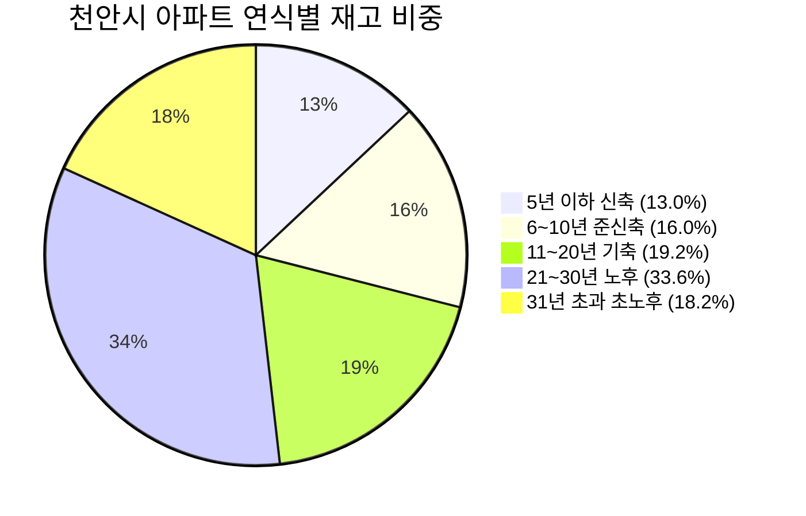

# [Market Intelligence Report] 충남 천안시 주택시장 종합 진단 및 미래 성장 전략 보고서
> **기준 시점**: 2026년 하반기 (원천 데이터: 부동산R114 PropX, KCB K-Atlas 2.0, 행정안전부 주민등록통계, 국토교통부 주택통계, 천안시 미래전략 개발계획)  
> **조사 및 분석**: 부동산 빅데이터 인텔리전스 리서치팀  
> **보고서 성격**: 천안시 주택 수급(분양·입주), 가격/청약 양극화, 미분양 급증 원인, 주택 재고 노후도, K-Atlas 차주 금융(소득·소비·대출), 광역 인구 이동(통근·이주), 핵심 개발호재 융합 턴키 분석 보고서

---

## Executive Summary (핵심 종합 요약)

```mermaid
flowchart TD
    subgraph SupplyDemand["1. 수급 사이클 및 청약 양극화 (Supply & Divergence)"]
        S1["2024~2025년 누적 입주 1.5만 세대<br/>(2024년 8,966세대 피크)"] --> S2["2026년 1.18만 세대 대규모 분양 러시<br/>(성성·업성·부대·두정 집중)"]
        S2 --> S3["청약 시장 극단적 초양극화<br/>(성성호수 26:1 완판 vs 외곽 0.02:1 미달)"]
        S3 --> S4["미분양 5,100호 급증 (26.07)<br/>(단기 재고 리스크 확대)"]
    end

    subgraph AgingReplacement["2. 재고 노후도 51.8% & 갈아타기 압력"]
        A1["전체 아파트 20.4만 호 중<br/>20년 초과 10.57만 호 (51.8%)"] --> A2["전용 60㎡ 이하 소형<br/>69.9%(55,932호) 극단적 노후"]
        A2 --> A3["신축 국민평형(74~84㎡)<br/>강력한 대기 환승 수요"]
    end

    subgraph EconomicEngine["3. 산업·소득 엔진 (Industrial Spill-over)"]
        E1["아산 생산 - 천안 소비 메커니즘<br/>(탕정 통근자 연소득 7,407만, 소비 331만)"] --> E2["삼성 저리 주거대출 복지 백업<br/>(연 1.5% 저리 최대 5억 대출)"]
        E2 --> E3["직산 1.2조 AI 데이터센터(AIDC)<br/>& K-반도체 패키징 벨트"]
    end

    subgraph SpatialCatalyst["4. 공간 축 이동 & 광역 교통 (Urban Pivot)"]
        C1["불당(1급지 노후화) ➔ 성성호수공원 & 탕정 연계축<br/>(과성교 2027년 개통, 신불당 3분 직결)"] --> C2["1호선 부성역(2029) & GTX-C 연장<br/>KTX 천안역 정차 추진"]
    end

    SupplyDemand --> Conclusion["[결론] 2026년 대규모 분양에 따른 단기 미분양 적체 국면이나,<br/>노후도 52% 교체 압력 및 고소득 일자리 배후 수요로<br/>성성·탕정 축 중심의 주거 가치 재편 가속화"]
    AgingReplacement --> Conclusion
    EconomicEngine --> Conclusion
    SpatialCatalyst --> Conclusion
```



1. **수급 사이클과 청약 시장의 극단적 초양극화 (성성호수공원 쏠림 vs 비선호지 미달)**
   * 천안시 주택시장은 2024년 8,966세대, 2025년 6,100세대의 대규모 입주를 소화한 후, **2026년 한 해 동안 11,880세대에 달하는 매머드급 신규 분양 물량**이 쏟아졌습니다.
   * 이에 따라 청약 시장은 극단적 양극화로 분열되었습니다. **성성호수공원 라인(엘리프 성성호수공원 1BL 26.27:1, 아이파크시티 6단지 10.54:1)**은 수천~1만 명의 청약 통장이 집중되며 완판된 반면, 동남구 삼룡동(동문디이스트 0.03:1), 직산읍(동일하이빌 0.03:1), 부대동(아이파크시티 4단지 0.17:1), 두정역 일대(0.13:1) 등은 대규모 미달을 기록했습니다.
   * 이로 인해 2025년 10월 1,032호 수준이었던 **미분양 주택은 2026년 7월 기준 5,100호로 급증**하여 단기적 수급 충격을 나타내고 있습니다.

2. **아파트 재고 노후도 51.8% 도래 및 소형 주택 70% 노후화의 강력한 교체 압력**
   * 천안시 전체 아파트 재고 204,032세대 중 **21년 이상 경과한 노후 주택이 105,727세대(51.8%)**로 도시 절반 이상이 노후화되었습니다.
   * 특히 전체 재고의 약 40%를 차지하는 **전용 60㎡ 이하 소형 주택은 79,984세대 중 무려 69.9%(55,932세대)가 20년 이상 노후화**되어, 과거 공급된 저층·노후 단지 거주자들의 주거 상향 및 신축 중형(전용 84㎡) 환승 대기수요가 임계점에 도달해 있습니다.

3. **K-Atlas 데이터로 실증된 '아산 생산 - 천안 소비'와 삼성 금융 복지 파워**
   * KCB K-Atlas 4,400만 빅데이터 분석 결과, 천안시 거주자의 외부 통근 1위는 **아산시 탕정면(삼성디스플레이·SDI)**으로, 이들 통근자의 **평균 연소득은 7,407만 원, 월카드소비는 331만 원**에 달합니다. 또한 용인시 기흥구 서농동(삼성전자 반도체) 통근자의 연소득은 **1억 455만 원**을 기록했습니다.
   * 특히 삼성 임직원 대상 **'연 1.5% 저리 주거대출 복지(최대 5억 원, DSR 미적용)'**는 천안·아산 권역의 고가 신축 시장을 떠받치는 독보적인 금융 백업 동력으로 작동하고 있습니다.

4. **도심 공간 축의 이동: 불당 포화에서 '성성호수공원' 및 '탕정-과성교 연계축'으로 이전**
   * 1급지 신불당이 입주 10년 차를 경과하며 단지 노후화가 시작된 가운데, 주거 선호 축이 **성성호수공원의 수변 생태 프리미엄 축**과 **2027년 개통 예정인 과성교를 통해 신불당 학원가와 3분 거리로 직결되는 아산 탕정 연계축**으로 급격히 이동하고 있습니다.
   * 여기에 **직산 1.2조 원 규모 AI 데이터센터(AIDC) 유치, 1호선 부성역 신설(2029년), GTX-C 천안 연장 추진, KTX 천안역 정차 구상** 등이 맞물리며 천안 북부·서북권의 미래 도시 경쟁력이 질적으로 도약하고 있습니다.

---

## 01. 천안시 도시 개황 및 거시 정주 여건 분석

### 1. 인구 및 세대수 추이 (인구 66.4만 돌파 및 1~2인 가구 분화 31.8만 세대)
* 천안시 총인구는 2008년 537,698명에서 2016년 617,955명, 2020년 658,808명으로 급성장한 후, **2025년 기준 664,322명**으로 지속적인 완만한 증가세를 유지하고 있습니다.
* 세대수는 1~2인 가구 급증 및 지속적인 신규 택지 입주로 2008년 209,512세대에서 **2025년 317,941세대**로 무려 108,429세대(+51.8%) 폭증했습니다. 이에 따라 세대당 인구는 2008년 2.57명에서 **2025년 2.09명**으로 크게 감소하여 실질 주택 수요층의 분화가 가속화되고 있습니다.

#### [표 1-1] 천안시 연도별 인구 및 세대수 변동 추이 (원천: 행정안전부 주민등록통계)
| 기준연도 | 총인구수 (명) | 전년대비 증감 | 총 세대수 (세대) | 전년대비 증감 | 세대당 인구 (명) | 인구 구조 및 시장 시사점 |
| :---: | :---: | :---: | :---: | :---: | :---: | :--- |
| **2008년** | 537,698 | - | 209,512 | - | 2.57 | 천안 도심 및 두정·쌍용지구 확장기 |
| **2010년** | 557,673 | +16,841 | 221,744 | +9,256 | 2.51 | 백석·신방지구 개발 진행 |
| **2012년** | 581,988 | +10,611 | 232,724 | +4,748 | 2.50 | 60만 인구 근접 |
| **2014년** | 598,346 | +7,257 | 243,364 | +4,687 | 2.46 | 불당신도시(신불당) 개발 본격화 |
| **2016년** | 617,955 | +12,179 | 254,676 | +6,981 | 2.43 | 인구 60만 명 돌파 안착 |
| **2018년** | 646,075 | +14,544 | 273,851 | +10,417 | 2.36 | 신불당 대규모 입주 성황기 |
| **2020년** | 658,808 | +6,550 | 291,425 | +10,092 | 2.26 | 성성지구 입주 및 세대수 29만 돌파 |
| **2022년** | 657,559 | -927 | 302,893 | +4,906 | 2.17 | 세대수 30만 돌파, 1인 가구 분화 |
| **2024년** | 659,920 | +3,961 | 312,542 | +6,124 | 2.11 | 풍세·노태·성성 대규모 입주 효과 |
| **2025년** | **664,322** | **+4,402** | **317,941** | **+5,399** | **2.09** | **인구 66만 및 세대수 31.8만 달성** |

---

### 2. 충남 경제 심장 & "아산 생산 - 천안 소비" 메커니즘 (`미래전략 보고서.docx` 융합)

```
┌─────────────────────────────────────────────────────────────────────────┐
│              [천안·아산 권역의 상생 분업 및 고소득 소비 순환 모델]              │
└─────────────────────────────────────────────────────────────────────────┘
        ▲                                                          ▲
        │ (소득 창출 & 주거대출 지원)                                  │ (주거 거주 & 프리미엄 소비)
┌───────┴──────────────┐                                   ┌───────┴──────────────┐
│  아산시 첨단 생산기지   ├───────────────────────────────────┤  천안시 고급 주거·상업  │
│  · 1인당 GRDP 1억+ 초과 │  [삼성 임직원 주거복지 대출]       │  · 신불당·성성 학원/상권 │
│  · 삼성디스플레이/SDI  │  연 1.5% 저리, 최대 5억 원       │  · 신세계/갤러리아 백화점│
│  · 현대차 아산공장     │  3년거치 10년상환 (DSR 규제 미적용)│  · 우수 학군 및 종합병원│
└──────────────────────┘                                   └──────────────────────┘
        ▲                                                          ▲
        │                                                          │
   [K-반도체 패키징] ─────────────────────────────────────────── [직산 1.2조 AIDC]
   판교(설계) ➔ 천안/온양(후공정 패키징) ➔ 아산(완성차/디스플레이)    전력(80MW)·용수 인프라 완비
```

1. **충남 경제 비중 50%를 합작하는 천안·아산 메가클러스터**:
   * 충청남도는 전국 1인당 GRDP 2위의 제조 강도이며, 천안과 아산은 도내 GRDP의 절반을 담당합니다. 특히 아산시는 1인당 GRDP 1억 원을 웃돌아 전국 평균의 2.3배를 기록하고 있습니다.
   * 천안시는 아산의 독보적 제조업 일자리(삼성, 현대차 등)에서 창출된 막대한 소득을 풍부한 상업(신세계·갤러리아), 우수 학군(신불당 명문 학원가, 명문고), 종합의료 인프라(단국대병원, 순천향대병원)를 통해 흡수하는 **"아산 생산 - 천안 소비" 구조**를 형성하고 있습니다.
2. **삼성 임직원 주거복지 제도의 강력한 하방 지지력**:
   * 삼성 계열사(전자, 디스플레이, SDI)는 무주택 및 갈아타기 임직원에게 **최대 5억 원(매매가 70% 한도), 연 1.5% 저리 금리(3년 거치 10년 상환)**의 주택자금 대출 복지를 2035년까지 제공합니다.
   * DSR 규제를 적용받지 않는 이 제도는 불당동 및 성성호수공원, 탕정 일대 전용 84㎡ 고가 분양권(5억~8억 원대)을 실질적으로 소화할 수 있는 강력한 유효수요 엔진입니다.
3. **직산 1.2조 AI 데이터센터(AIDC) 및 미래 전력·수자원 경쟁력**:
   * 직산읍 군서리 일원 1.2조 원 규모 AI 데이터센터 유치는 '역세권'을 넘어 전력과 용수를 선점하는 **'전세권(電勢權)' 경쟁력**을 입증했습니다. 둔포변전소(154kV)로부터 80MW 전력을 조달하고 248억 원 규모 배수지 확장을 완비하여 미래 첨단 산업 거점으로서의 세수 기반을 확보했습니다.

---

### 3. 천안시 도심 공간 구조 변천 및 4대 핵심 주거 거점 비교

#### [도심 공간 확장 연대기]
```
천안역(원도심) ➔ 신부동(터미널·상권) ➔ 쌍용동(택지개발) ➔ 두정·백석동(북부확장) ➔ 불당·신불당(1급지 완성) ➔ 성성호수공원 & 탕정 연계축(수변·광역 결합)
```

#### [표 1-2] 천안시 주요 4대 주거 권역 심층 비교 진단 (`개발보고서.docx` 반영)
| 주거 권역 | 핵심 권역 및 주요 단지 | 핵심 경쟁력 및 입지 가치 | 한계점 및 입지적 리스크 | 향후 시장 전망 및 위상 |
| :--- | :--- | :--- | :--- | :--- |
| **신불당 권역** | 불당지웰더샵, 불당지웰푸르지오, 호반베르디움 | • 천안시 독보적 최상위 1급지 위상<br/>• 대규모 명문 학원가(충남 최대) 및 행정·상업 집중<br/>• 천안시청, 천안아산역 KTX/SRT 접근성 우수 | • 입주 8~10년 차 경과에 따른 노후화 시작<br/>• 신축 브랜드 단지로의 주거 이전 욕구 증가<br/>• 매매가 7~9억 원대 진입 장벽 | 전통 부촌으로서의 위상은 유지되나, 신축 프리미엄을 갖춘 성성 및 탕정으로 일부 수요 분산 |
| **성성호수공원 권역** | 천안아이파크시티(1~6단지), 성성푸르지오, 엘리프, 동원비스타 | • 성성호수공원 영구 조망 및 쾌적한 친환경 수변<br/>• 삼성 SDI, 천안 2·3·4 일반산단 직주근접 최고<br/>• 아이파크, 푸르지오, 자이 등 1군 브랜드 대단지 타운 | • 2026년 대규모 분양 집중 및 2029년 입주 몰림<br/>• 초·중교 신설 및 통학 인프라 조율 필요<br/>• 단기 전세가 변동성 리스크 | **천안의 새로운 대장 신흥 부촌 등극**, 젊은 고소득 연구원 및 대기업 직장인 최선호 주거지 |
| **탕정-신불당 연계축** | 탕정자이, 탕정푸르지오, 탕정역세권 단지 | • **과성교(2027년 하반기 개통)**로 신불당 3분 직결<br/>• 신불당 학원가 셔틀 공유 + 농어촌 특별전형 자격<br/>• 삼성 디스플레이 사업장 직주근접 극대화 | • 과성교 개통 이전까지 임시 우회 통행 불편<br/>• 행정구역(아산시) 분리에 따른 행정 서비스 차이 | 신불당 인프라를 흡수하는 실질적 불당 확장 생활권으로 3040 맞벌이 학부모 선호 극대화 |
| **천안역 원도심 재개발** | 문성원성 한성필하우스, 힐스테이트천안, 원도심 아이파크 | • 천안역 도시재생 및 1군 브랜드 턴어라운드<br/>• 복자여고, 천안고, 천안중 등 전통 명문 학군 인접<br/>• 신세계백화점, 이마트, 터미널 상권 도보권 | • 서북구 신도심 대비 주변 정주환경 정비 지연<br/>• 청약 미달 발생 등 실수요 회복에 시간 소요 | KTX 정차 및 1호선 환승 거점화 추진으로 장기적 도심 재생 가치 점진적 부각 |

---

## 02. 천안시 주택 재고 및 노후도 심층 분석

### 1. 면적별 주택 재고 현황 (`천안노후도.png` 전수 분석)
천안시 아파트 재고는 총 **204,032세대**이며, 전용 60~85㎡(국민평형)가 48.1%, 전용 60㎡ 이하 소형이 39.2%로 중소형 실수요 중심 구조를 보입니다.

#### [표 2-1] 천안시 아파트 면적별 공급 재고 현황
| 전용면적 구분 | 전체 세대수 (세대) | 재고 점유비 (%) | 최근 분양 공급 비중 (선택기간) | 공급 수급 평가 |
| :--- | :---: | :---: | :---: | :--- |
| **60㎡ 이하 (소형)** | 79,984 | 39.2% | 27.7% (16,611세대) | 과거 구도심·쌍용·두정에 집중 공급되었으나 최근 비중 축소 |
| **60~85㎡ (국민평형)** | 98,106 | **48.1%** | **64.4% (38,618세대)** | **최근 신규 분양의 64.4%를 차지하는 핵심 주력 평형** |
| **85㎡ 초과 (중대형)** | 25,941 | 12.7% | 8.0% (4,774세대) | 고소득 전문직·대기업 임원 수요 대비 신규 공급 희소 |
| **합계** | **204,032** | **100.0%** | **100.0% (60,003세대)** | **중형 중심 공급 재편 및 대형 평형 희소성 심화** |

---

### 2. 연식별 주택 노후도 구조 및 주거 상향(이전) 압력

#### [표 2-2] 천안시 아파트 규모별 노후도 전수 현황표 (원천: 천안노후도.png)
| 규모 구분 | 전체 세대 | 5년 이하 (신축) | 6~10년 (준신축) | 11~20년 (기축) | 21~30년 (노후) | 31년 초과 (초노후) | 20년 초과 노후 세대 | 20년 초과 노후율 |
| :--- | :---: | :---: | :---: | :---: | :---: | :---: | :---: | :---: |
| **60㎡ 이하** | 79,984 | 5,337 | 10,887 | 7,828 | 34,280 | 21,652 | **55,932** | **69.9%** |
| **60~85㎡** | 98,106 | 19,705 | 18,447 | 20,458 | 27,085 | 12,411 | **39,496** | **40.3%** |
| **85㎡ 초과** | 25,941 | 1,455 | 3,319 | 10,868 | 7,190 | 3,109 | **10,299** | **39.7%** |
| **전체 합계** | **204,032** | **26,497** | **32,653** | **39,154** | **68,555** | **37,172** | **105,727** | **51.8%** |
| **비중 (%)** | **100.0%** | **13.0%** | **16.0%** | **19.2%** | **33.6%** | **18.2%** | **(총 10.57만 호)** | **(도시 과반 노후)** |



#### [분석 인사이트: 노후 소형 5.6만 세대의 '신축 국민평형 환승 욕구']
1. **소형 주택의 70%가 20년 초과 노후 (55,932세대)**:
   * 60㎡ 이하 소형 아파트 79,984세대 중 21년 이상 경과한 노후 주택이 **55,932세대(69.9%)**에 달합니다. 1990년대 쌍용동·신부동 일대에 대량 보급된 복도식·저층 소형 주택들이 주거 환경 열화(주차난, 배관 노후)를 겪으며, 쾌적한 신축 중형(전용 74~84㎡)으로 갈아타려는 강력한 내부 대기수요를 형성하고 있습니다.
2. **신축 재고 비중 13.0%에 불과, 신축 프리미엄 지속**:
   * 5년 이하 신축 아파트는 26,497세대로 전체의 13.0%에 불과합니다. 준신축(6~10년, 16.0%)을 포함해도 10년 이내 아파트는 29.0%에 그쳐, 최신 커뮤니티와 주차 공간을 갖춘 브랜드 신축에 대한 프리미엄 선호도가 높게 유지되고 있습니다.

---

## 03. 아파트 수급 동향 (분양·입주) 및 청약·미분양 진단

### 1. 연도별 분양 실적 및 입주 공급물량 비교 (2020~2030년)
천안시 주택 수급 곡선은 **2024년 8,966세대의 입주 피크**에 이어 **2026년 11,880세대의 대규모 분양 러시**가 발생하고, 이것이 **2029년 12,598세대의 매머드급 입주**로 연결되는 뚜렷한 사이클을 보이고 있습니다.

#### [표 3-1] 천안시 연도별 분양 및 입주 물량 추이 (단위: 세대)
| 연도 | 분양 물량 (동남/서북) | 입주 공급 (동남/서북) | 천안 수급 밸런스 평가 | 시장 핵심 이벤트 및 동향 |
| :---: | :---: | :---: | :---: | :--- |
| **2020년** | 4,649 (3,626 / 1,023) | 5,769 (711 / 5,058) | 수급 균형 | 두정·성성권 신규 공급 |
| **2021년** | 7,259 (5,027 / 2,232) | 1,458 (466 / 992) | 분양 확대 | 유동성 장세 속 삼룡·청당·부성 분양 |
| **2022년** | 10,270 (4,358 / 5,912) | 4,030 (2,525 / 1,505) | 고분양 피크 | 노태포레나, 롯데캐슬 등 대규모 분양 |
| **2023년** | 358 (0 / 358) | 6,712 (4,844 / 1,868) | 분양 급감 | 고금리·PF 위축으로 신규 분양 올스톱 |
| **2024년** | 3,928 (0 / 3,928) | **8,966 (4,425 / 4,541)**| **입주 피크 (공급 부담)**| 한양수자인(3,200), 성성동원, 노태포레나 입주 |
| **2025년** | 6,553 (1,611 / 4,942) | 6,100 (3,016 / 3,084) | 입주 소화 국면 | 롯데캐슬더청당, 힐스테이트두정역 입주 |
| **2026년** | **11,880 (1,638 / 10,242)**| **689 (689 / 0)** | **일시적 입주 급감 & 분양 폭증** | **호반써밋 1BL(453호) 외 서북구 입주 0호, 1.18만 분양 러시** |
| **2027년** | - | 5,405 (1,871 / 3,534) | 입주 정상화 | 힐스테이트천안역스카이움, 호반써밋 2BL 입주 |
| **2028년** | - | 4,089 (0 / 4,089) | 서북구 입주 집중 | e편한세상성성호수공원, 성성자이, 아이파크 2단지 |
| **2029년** | - | **12,598 (2,253 / 10,345)**| **역대 최대 입주 도래** | **성성·업성·부대 아이파크시티/푸르지오/엘리프 대거 입주** |
| **2030년** | - | 1,438 (0 / 1,438) | 공급 안정 | 두정역푸르지오그랑피크 입주 |

---

### 2. 2026년 주요 단지별 청약 결과 분석 (성성호수공원 대박 vs 외곽 참패)

#### [표 3-2] 천안시 주요 아파트 단지별 청약 경쟁률 전수 분석
| 아파트 단지명 | 소재지 (구/동) | 총 세대 | 일반 공급 | 1순위 접수 | 1순위 경쟁률 | 전체 경쟁률 | 청약 결과 및 시장 평가 |
| :--- | :--- | :---: | :---: | :---: | :---: | :---: | :--- |
| **엘리프성성호수공원(1BL)** | 서북구 업성동 | 546 | 379 | **9,956** | **26.27 : 1** | **26.27 : 1** | **천안 최고 청약 흥행 (1만 명 쇄도, 완전 완판)** |
| **천안아이파크시티(6단지)** | 서북구 성성동 | 1,066 | 766 | **8,077** | **10.54 : 1** | **11.01 : 1** | **성성호수공원 최선호 대단지 1순위 마감** |
| **천안아이파크시티(5단지)** | 서북구 성성동 | 882 | 662 | **5,848** | **8.83 : 1** | **9.32 : 1** | **6단지와 동반 흥행, 1순위 조기 완판** |
| **엘리프성성호수공원(2BL)** | 서북구 업성동 | 619 | 510 | **2,368** | **4.64 : 1** | **5.23 : 1** | **수변 조망권 프리미엄으로 1순위 완판** |
| **백석시그니처자이(2단지)** | 서북구 백석동 | 320 | 304 | 356 | **1.17 : 1** | **1.35 : 1** | 백석동 기구축 배후 갈아타기로 마감 |
| **업성푸르지오레이크시티(1BL)** | 서북구 업성동 | 1,460 | 1,400 | 1,553 | **1.11 : 1** | **1.20 : 1** | 매머드급 대단지 1순위 턱걸이 마감 |
| **백석시그니처자이(1단지)** | 서북구 백석동 | 854 | 792 | 828 | **1.05 : 1** | **1.21 : 1** | 도심 입지로 1순위 선방 마감 |
| **천안용곡두산위브** | 동남구 용곡동 | 409 | 46 | 11 | 0.24 : 1 | 0.39 : 1 | 구도심 소규모 단지 1순위 미달 |
| **두산위브더제니스센트럴천안** | 동남구 청당동 | 1,202 | 1,160 | 323 | 0.28 : 1 | 0.34 : 1 | 청당동 공급 과잉 및 고분양가 부담 미달 |
| **천안아이파크시티(3단지)** | 서북구 부대동 | 896 | 838 | 193 | 0.23 : 1 | 0.27 : 1 | 성성호수공원 이격 및 북측 입지 한계 미달 |
| **천안아이파크시티(4단지)** | 서북구 부대동 | 818 | 771 | 128 | 0.17 : 1 | 0.20 : 1 | 3단지와 동반 미달 발생 |
| **업성푸르지오레이크시티(2단지)** | 서북구 업성동 | 448 | 442 | 55 | 0.12 : 1 | 0.16 : 1 | 1BL 대비 선호도 열세로 미달 |
| **두정역푸르지오그랑피크** | 서북구 성정동 | 1,438 | 1,382 | 182 | 0.13 : 1 | 0.16 : 1 | 대단지 분양가 부담 및 두정동 기공급 누적 미달 |
| **천안동일하이빌파크레인** | 서북구 직산읍 | 895 | 888 | 29 | 0.03 : 1 | 0.04 : 1 | 외곽 산단 배후지 청약 수요 부재로 참패 |
| **천안동문디이스트파크시티** | 동남구 삼룡동 | 1,051 | 498 | 13 | 0.03 : 1 | 0.05 : 1 | 동남구 외곽 입지 및 인프라 부족으로 대거 미달 |

---

### 3. 미분양 추이 및 급증 원인 심층 분석

```
[천안시 미분양 주택 재고 추이] (단위: 호)
 5,500 ──                                                                          5,100 (26.07)
 5,000 ──                                                                            ▲
 4,500 ──                                                                            │
 4,000 ──                                                                   3,939 (26.06)
 3,500 ──                                                      3,361 (26.02)         │
 3,000 ──                                          2,769       3,113   3,060 3,162   │
 2,500 ──                                      2,566   2,614     │       │     │     │
 2,000 ──                                        │       │       │       │     │     │
 1,500 ── 1,590 1,415 1,249 1,331 1,353 1,325    │       │       │       │     │     │
 1,000 ──   │     │     │     │     │     │      │       │       │       │     │     │
   500 ──   │     │     │     │     │     │   1,032(25.10)       │       │     │     │
     0 ──┴─────┴─────┴─────┴─────┴─────┴─────┴───────┴───────┴───────┴─────┴─────┴─────
         24.07 24.09 24.11 24.12 25.03 25.05 25.10   25.11   26.01   26.02 26.04 26.07
```

* **미분양 급증(1,032호 ➔ 5,100호) 3대 원인**:
  1. **단기 분양 물량의 폭발적 집중 (2026년 11,880세대)**: 2023년 분양 위축(358호) 이후 건설사들이 2026년 상반기에 일제히 밀어내기 분양을 진행하면서 수요 분산이 일어났습니다.
  2. **성성호수공원 쏠림 현상에 따른 비선호지 외면**: 청약 통장 약 2.6만 개가 엘리프(1BL·2BL) 및 아이파크시티(5·6단지)에 몰리면서, 삼룡동(동문), 청당동(두산), 직산읍(동일), 부대동(아이파크 3·4단지) 등은 수요가 실종되어 잔여 물량이 고스란히 미분양으로 전락했습니다.
  3. **분양가 상승 및 고금리 환경**: 3.3㎡당 1,500만~1,700만 원대로 상승한 분양가에 대해 실수요자들이 입지와 브랜드에 따라 엄격한 '옥석 가리기'를 적용한 결과입니다.

---

## 04. K-Atlas 기반 차주 금융 및 광역 공간 이동(통근/이주) 인텔리전스

### 1. 읍·면·동별 금융 프로파일 (소득, 소비, 주택담보대출 맵)
KCB 4,400만 금융 데이터(K-Atlas 2.0, 2026.08 기준) 분석 결과, 천안시는 **서북구(평균 연소득 4,900만 원, 주담대 1.45억 원)가 동남구(평균 연소득 4,354만 원, 주담대 1.24억 원)를 압도**하고 있습니다.

#### [표 4-1] 천안시 주요 읍·면·동별 금융 프로파일 (K-Atlas 2026.08 기준)
| 순위 | 시군구 | 읍·면·동 | 평균 연소득 (만원) | 월평균 카드소비 (만원) | 주택담보대출 잔액 (만원) | 이주 비율 (%) | 계속거주 비율 (%) | 지역 금융 및 주거 성격 |
| :---: | :--- | :--- | :---: | :---: | :---: | :---: | :---: | :--- |
| **1위** | **서북구** | **불당2동** | **6,684** | **324** | **20,683** | 2.39% | 4.16% | **천안 최고 부촌, 전문직·대기업 고소득 차주 밀집** |
| **2위** | **서북구** | **불당1동** | **6,054** | **262** | **16,679** | 1.82% | 3.89% | 전통 신불당 주거지, 높은 소비 여력 |
| **3위** | **서북구** | **백석동** | **5,400** | 225 | 15,127 | 2.51% | 4.93% | 삼성전자/SDI 배후 안정적 중산층 주거지 |
| **4위** | **서북구** | **쌍용3동** | **5,340** | 225 | 12,792 | 1.14% | 2.29% | 쌍용동 내 자영업자 및 자산가 거주 |
| **5위** | **서북구** | **부성2동** | **5,258** | **222** | **16,709** | **4.71%** | **7.80%** | **성성지구 신흥 부촌, 이주·거주율 최고 (신축 프리미엄)** |
| **6위** | **서북구** | **부성1동** | 4,720 | 199 | 15,791 | **4.94%** | 7.13% | 두정 북부 및 부성지구 신흥 주거 축 |
| **7위** | **동남구** | **청룡동** | 4,667 | 203 | 13,740 | 3.79% | 7.56% | 청수행정타운 배후 동남구 최고 주거지 |
| **8위** | **서북구** | **쌍용2동** | 4,555 | 175 | 10,423 | 2.76% | 4.67% | 쌍용동 중심 기구축 주거지 |
| **9위** | **동남구** | **신방동** | 4,514 | 194 | 11,159 | 3.14% | 5.55% | 신방통정지구 배후 가족단위 실수요 |
| **10위**| **동남구** | **신안동** | 4,340 | 149 | 13,953 | 4.00% | 6.30% | 신부동 터미널 및 원도심 상권 배후지 |
| **11위**| **서북구** | **직산읍** | 4,116 | 134 | 9,754 | 1.57% | 3.31% | 산업단지 배후 근로자 주거지 |
| **-** | **서북구** | **서북구 평균** | **4,900** | **194** | **14,497** | **32.17%** | **55.26%** | **천안시 경제력 및 소비 주도 (불당·성성·백석)** |
| **-** | **동남구** | **동남구 평균** | **4,354** | **165** | **12,363** | **20.28%** | **37.44%** | **서북구 대비 소득 -546만원, 주담대 -2,134만원** |

---

### 2. 광역 통근 유출입 네트워크 분석 (아산 탕정 & 수도권 반도체)

```mermaid
flowchart LR
    subgraph Outflow["천안시 거주자의 외부 주요 통근지 (근무지)"]
        A1["충남 아산시 탕정면 (삼성디스플레이)<br/>★ 통근비율 2.76% | 연소득 7,407만 | 월소비 331만"]
        A2["충남 아산시 음봉·배방·둔포면<br/>★ 산단 통근 5.79% | 연소득 5,100~5,500만"]
        Y1["경기 용인시 기흥구 서농동 (삼성전자 반도체)<br/>★ 통근비율 0.41% | 연소득 1억 455만 | 소비 462만"]
        A3["충남 아산시 인주면 (현대자동차)<br/>★ 통근비율 0.38% | 연소득 6,867만 | 소비 296만"]
        S1["서울 강남구 역삼1동 (테헤란로 IT/금융)<br/>★ 통근비율 0.28% | 연소득 5,012만 | 소비 207만"]
    end

    subgraph Core["충남 천안시 (핵심 주거지)"]
        CN["불당동 & 성성호수공원 & 백석동<br/>(우수한 학군, 백화점/병원, 쾌적한 신축 주거환경)"]
    end

    subgraph Inflow["천안시로의 외부 전입 (이주 유입)"]
        I1["아산시 배방읍 (2.49%)<br/>소득 4,942만 | 주담대 1.83억"]
        I2["아산시 탕정면 (1.16%)<br/>소득 5,633만 | 주담대 2.02억"]
        I3["경기 평택시 고덕동 (0.21%)<br/>소득 5,276만 | 주담대 3.08억"]
        I4["충북 청주시 오창읍 (0.25%)<br/>소득 5,145만 | 카드소비 339만"]
    end

    CN --> Outflow
    Inflow --> CN
```



#### [표 4-2] 천안시 거주자의 외부 통근 유출 상위 8대 지역
| 순위 | 근무지 시군구 | 근무지 읍·면·동 | 통근 비중 (%) | 차주 연소득 (만원) | 월카드소비 (만원) | 통근 목적 및 핵심 산업군 |
| :---: | :--- | :--- | :---: | :---: | :---: | :--- |
| **1위** | **충남 아산시** | **탕정면** | **2.76%** | **7,407** | **331** | **삼성디스플레이시티 아산캠퍼스 핵심 연구·생산직** |
| **2위** | **충남 아산시** | **음봉면** | **2.47%** | 5,034 | 244 | 아산 제2디지털산단 및 첨단 협력사 벨트 |
| **3위** | **충남 아산시** | **배방읍** | **2.25%** | 5,514 | 298 | KTX 천안아산역 R&D 집적지구 및 IT 산업 |
| **4위** | **충남 아산시** | **둔포면** | **1.07%** | 5,303 | 251 | 아산테크노밸리 산업단지 제조 기술인력 |
| **5위** | **경기 용인시 기흥구** | **서농동** | **0.41%** | **10,455** | **462** | **삼성전자 기흥/화성캠퍼스 반도체 핵심 연구인력** |
| **6위** | **충남 아산시** | **인주면** | **0.38%** | **6,867** | **296** | **현대자동차 아산공장 완성차 제조 핵심 엔지니어** |
| **7위** | **충남 아산시** | **온양3동** | **0.37%** | 5,439 | 350 | 아산시 행정·금융·의료 중심지 통근 |
| **8위** | **서울 강남구** | **역삼1동** | **0.28%** | 5,012 | 207 | KTX/SRT 고속철도를 이용한 강남권 통근자 |

---

### 3. 광역 전입/이주 네트워크 분석
* **아산시로부터의 강력한 역유입 (배방 2.49% + 탕정 1.16% + 음봉 0.86% = 합계 4.51%)**:
  * 아산 배방·탕정 거주 가구가 자녀 교육(신불당 명문 학원가)과 풍부한 상업 시설을 위해 천안(불당, 성성, 백석) 신축으로 전입하는 흐름이 뚜렷합니다.
* **평택 고덕 및 청주 오창으로부터의 광역 유입**:
  * 평택 고덕동(주담대 3.08억 원, 고소득 차주)의 높은 집값/전세가를 피해 북천안으로 유입되는 수요와, 오창 2차전지 산단에서 천안 동남권으로 유입되는 광역 수요가 확인됩니다.

---

## 05. 광역 교통망 확충 및 핵심 인프라 미래가치

```
┌─────────────────────────────────────────────────────────────────────────┐
│                    [천안시 광역 교통 혁신 및 미래 인프라 맵]                    │
└─────────────────────────────────────────────────────────────────────────┘
         수도권 ➔ 천안 ➔ 아산 ➔ 호남/경부축 통합 고속철도망
┌─────────────────────────┐                     ┌─────────────────────────┐
│   수도권 1호선 부성역   │                     │  탕정-신불당 과성교 개통 │
│ (2029년 개통, 성성·부성) │                     │ (2027년 하반기, 3분 연결)│
└───────────┬─────────────┘                     └───────────┬─────────────┘
            │                                               │
┌───────────┴─────────────┐                     ┌───────────┴─────────────┐
│    GTX-C 천안 연장 추진  ├─────────────────────┤      KTX 천안역 정차     │
│ (수원~천안 광역급행철도) │                     │ (수원-대전 4회 무정차 연계)│
└─────────────────────────┘                     └─────────────────────────┘
```

#### [표 5-1] 천안시 핵심 광역 교통 인프라 추진 현황 (`미래전략 보고서.docx` 융합)
| 사업명 | 주요 내용 및 현황 | 정책적 평가 및 주택시장 파급효과 |
| :--- | :--- | :--- |
| **과성교 신설 (2027 하반기)** | • 탕정지구와 신불당을 KTX 선로 상부로 직결하는 왕복 교량<br/>• 공사 완료 시 탕정자이 등에서 신불당 학원가 차량 3~5분 도달 | **탕정의 신불당 생활권 완전 편입**, 성성-불당-탕정으로 이어지는 거대 프리미엄 주거벨트 완성 |
| **수도권 1호선 부성역 (2029)** | • 두정역과 직산역 사이 신설 (부대동·성성동 배후)<br/>• 2029년 개통 목표로 설계 및 시공 추진 중 | 성성호수공원 및 부성지구 주민들의 대중교통 접근성 획기적 개선, 역세권 프리미엄 형성 |
| **GTX-C 천안 연장** | • 덕정~수원 노선을 천안·아산까지 연장 추진<br/>• 지자체 재정 부담 완화를 위한 제5차 국가철도망 계획 반영 추진 | 서울 삼성역 및 강남권 40~50분대 주파 가능, 수도권 직주근접 메가시티로의 도약 발판 |
| **KTX 천안역 정차 추진** | • 수원-대전 구간 일 4회 무정차 KTX의 천안역 정차 도모<br/>• 기존 경부선로를 활용한 저비용·고효율 사업 | 천안역 원도심 재개발 단지들의 광역 교통 접근성 극대화 및 도심 재생 가치 부스트 |
| **흑성산·용연저수지 관광벨트**| • 흑성산 복합관광벨트(케이블카, 전망대) 및 용연저수지 둘레길<br/>• 도심 힐링·생태 문화 인프라 확충 | 서북구 집중 성장에 대응하여 동남구의 정주 쾌적성 및 관광 부가가치 증대 |

---

## 06. 종합 평가 (SWOT) 및 시장 전략적 제언

### 1. 천안시 주택시장 SWOT 매트릭스 분석

| 구분 | 내부 역량 (Internal Factors) | 외부 환경 (External Factors) |
| :---: | :--- | :--- |
| **강점 (Strength)** | • **20년 초과 노후 아파트 51.8%(소형 70%)의 막강한 환승 대기수요**<br/>• 불당2동(6,684만), 불당1동(6,054만) 등 충남 최고의 고소득·금융자산 보유<br/>• 성성호수공원 중심의 압도적 청약 완판 파워 (최고 26:1) | • 아산 탕정면 삼성디스플레이(연소득 7,407만) 고소득 직주근접 배후<br/>• **삼성 임직원 주거대출 복지(연 1.5% 저리 최대 5억, DSR 미적용)**<br/>• 과성교(2027), 1호선 부성역(2029), GTX-C 연장 등 광역 교통호재 |
| **약점 (Weakness)** | • **2026년 분양 러시(1.18만)로 인한 미분양 5,100호 적체**<br/>• 성성호수공원 외곽 및 원도심·직산 등 비인기 입지의 청약 참패 (양극화)<br/>• 서북구(4,900만)와 동남구(4,354만) 간의 심각한 지역 격차 | • 시중 고금리 기조 유지에 따른 매수 관망세 및 PF 대출 규제<br/>• **2029년 12,598세대 대규모 입주 집중**에 따른 중기 전세가 흔들림 리스크<br/>• 수도권 외곽 비규제지역에 대한 외지 갭투자 수요 유입 제약 |

---

### 2. 미래 주택시장 3대 전망 및 실무 수주·마케팅 권고사항

1. **[미분양 해소 국면] 2026년 일시적 입주 급감(689세대)을 활용한 미분양 자연 소진 유도**:
   * 현재 미분양 5,100호는 2026년 상반기 11,880세대 분양 집중에 따른 '착시성 단기 적체' 성격이 강합니다.
   * 중요한 점은 **2026년 천안시 신규 입주 물량이 단 689세대(서북구는 0세대)**에 불과하다는 사실입니다. 신규 입주 공백과 연 5,000세대 이상의 가구 분화가 맞물려, 2026년 말부터 2027년 상반기 사이에 준공 전 미분양 매물들이 점진적으로 소화될 것입니다. 단, 외곽 비선호 단지는 할인 분양 또는 금융 혜택(계약금 정액제, 중도금 무이자) 제공이 불가피합니다.

2. **[타겟 마케팅] '노후 소형 5.6만 세대 갈아타기' 및 '탕정 삼성 임직원 대출 복지' 정밀 공략**:
   * **내부 갈아타기 타겟**: 천안시 내 20년 이상 노후 소형 아파트에 거주하는 55,932세대를 대상으로, 넉넉한 수납공간과 4Bay 판상형 구조를 갖춘 **전용 74~84㎡(국민평형)** 이전 마케팅을 전개해야 합니다.
   * **삼성 대출 활용 타겟**: 연 1.5% 저리 5억 원 대출이 가능한 아산 탕정 및 천안 사업장 삼성 임직원을 타겟으로, 과성교 개통 수혜 단지 및 성성호수공원 신축의 '직주근접 + 신불당 학원가 공유' 가치를 집중 소구하는 전략이 필수적입니다.

3. **[수주 및 상품 전략] 2029년 입주 쇼크(1.26만 세대) 대비 리스크 관리 및 중대형 희소 상품 기획**:
   * 2029년에는 아이파크시티, 푸르지오, 엘리프 등 성성·부대·업성 지구에만 1.2만 세대가 넘는 입주가 집중되어 단기 전세가 하락 및 역전세 리스크가 발생할 수 있습니다. 시공사 및 시행사는 입주 지정 기간을 탄력적으로 운영하고 전세 연계 케어 프로그램을 선제적으로 구축해야 합니다.
   * 아울러 천안시 아파트 재고 중 중대형(85㎡ 초과)은 12.7%에 불과하므로, 불당·성성의 고소득 전문직(의사, 연구원, 임원)을 겨냥한 **전용 99~114㎡ 중대형 펜트하우스 및 테라스 특화 평면**을 전략적으로 공급할 것을 적극 권고합니다.

---
* **보고서 문의처**: 부동산 빅데이터 인텔리전스 리서치팀  
* **참조 데이터 원본**: `월간자료 > 천안 > 기초자료` (미래전략 보고서.docx, 천안노후도.png, 미분양/분양/입주/청약 통계 xlsx, KCB K-Atlas 이주/통근 xls)
